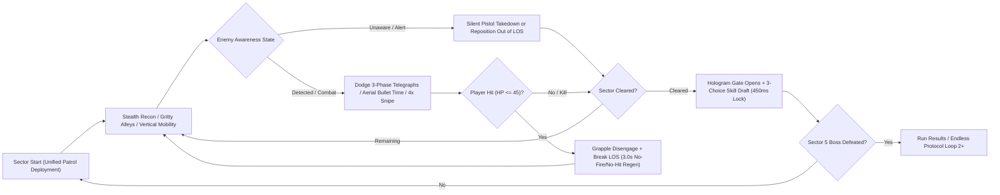
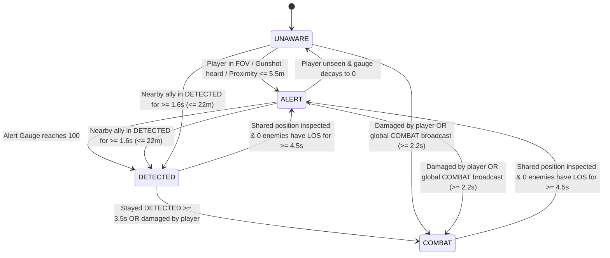

# STRAND // PROTOCOL — Complete Game Design & Technical Specification (v1.7)

**Target Implementer**: Claude (TypeScript / Three.js / WebGL2 / Web Audio API)  
**Genre**: Rain-Soaked Multi-Layer Cyberpunk City · Hardcore 3D Aerial-Mobility & Tactical Stealth FPS × Sector-Progression Roguelite  
**Document Purpose**: Master technical specification defining every game mechanic, physics formula, state machine, 3D rendering/shader pipeline, procedural humanoid rig & 4-state AI, Web Audio API DSP synth, parameter table, file architecture, and performance cap so the implementation AI executes at production quality without guesswork or omissions.

> [!NOTE]
> **Version History Summary**
> - **v1.1 (Multi-Layer City)**: Replaced isolated rooftop islands with a continuous multi-layer cyberpunk neon city: wet streets (`Y = 0.0m`) with parked cybercars, canal (`Y = -2.4m`) & truss bridges, passable elevated highway (`Y = 9.5m`, underpass clearance `>= 7.8m`), and dense high-rises (`16m–95m`).
> - **v1.2 (Phase 5 — `PHASE5_BRUSHUP_PLAN.md`)**: Unified Tactical Zoom (ADS) on RMB hold, Grapple range `130m` / speed `340 m/s`, real-time (`1.0x`) gear ops during Bullet Time, full audio mute on pause/tab blur.
> - **v1.3 (Phase 6 — `PHASE6_BRUSHUP_PLAN.md`)**: 4 architectural building archetypes, parallax interiors, 3D balconies, climbable fire escapes, 5-finger articulated hands & beveled holo-sight weapons, parallel-only wall-run on any vertical surface (`±35°`, `>= 6.5 m/s`), and §11 future online memo.
> - **v1.4 (Phase 7 — `PHASE7_BRUSHUP_PLAN.md`)**: Clear untinted optics, zero-lag ADS & sensitivity max `10.0`, solid opaque 1F storefronts, ADS enemy neon rim highlight, two-hand tactical reloads, auto-mantle, crouch, safe grapple reel-in, anisotropic wet-road streaks, height fog & film grade, volumetric lamp cones, traffic signals, alley wires, 6-color parked cars + ground light pools, giant blimps, beveled enemy armor + contact shadows, ground rain splashes, bullet smoke trails, and adaptive HUD.
> - **v1.5 (Phase 8A — `PHASE8_BRUSHUP_PLAN.md`)**: Full English master spec; inverted wall-run camera roll fix; lower crouch (`0.78m`) & slide (`0.68m`) eye heights; streamlined weapon roster to **Suppressed Pistol + Single-Shot 4x Rail Sniper + Grapple** (`[1]/[2]/[3|Q]`); unified SMG-sized open holo hood; lower ADS sensitivity (`0.55x` / `0.20x`); reworked `SK_07` (Shadow Step) & `SK_09` (Shield Piercer); **4-State Stealth / Alert / Detected / Combat AI** with unified initial sector deployment (Sectors 1–4). *(Phase 8B superseded and absorbed into Phase 9.)*
> - **v1.6 (Phase 9 — `PHASE9_CITY_OVERHAUL_PLAN.md`)**: Floor-grid-quantized cyberpunk architecture, `1.05 m` rooftop parapets, 5 building massings (incl. walkable `GALLERY_DANCHI` exterior corridors), 5 unified cyberpunk ground-floor programs, baked vertex AO (`aAo`), per-door/bay `PropSocket` individualized micro-props, alley clutter, wall graffiti, wall pipes, glowing steaming manholes, and `960` neon signs.
> - **v1.7 (Phase 10 — `PHASE10_OVERHAUL_PLAN.md`)**: Zero-lag 60fps GPU pipeline (`MSAA 2x`, half-res Bloom, `CITY_LIGHTS_MAX = 12` squared-distance cull, pixel cap `<= 2.2M px`, pre-render late mouse delta sync, optional Shadows toggle); fixed wet-road mercury ripple & glowing white wire-rack bugs + weathered surface detail on all props/steel + ground contact shadows; 3D first-person gunshot muzzle flash (Pistol & Sniper); **5 selectable full-screen atmospheric filters** (`CYBER_NOIR`, `NEON_OVERDRIVE`, `COLD_STEEL`, `AMBER_DUST`, `RAW`); fixed mobile-enemy **`ALERT` investigation movement** (always walks/flies to inspect spotted/heard location before decaying); **top-left circular pulse-scan mini-radar** (`3.5 s` sweep, `75 m` range, elevation `▲`/`▼`); **zero empty barren lots (`>= 92%` lot fill)**; **giant avenue-facing & 90° L-corner wrap-around Mega-Billboards**; **4 iconic cyber megastructures** (`X_TRUSS_TOWER`, `CYLINDER_RING_TOWER`, `TWIN_ARCH_GATE`, `SLANT_CORP_TOWER`); and distinct per-sector themes across Sectors 1–5.

---

## 0. Non-Negotiable Rules

> [!CAUTION]
> The following 8 pillars are the core identity of `STRAND // PROTOCOL`. Do NOT omit, simplify, or silently relax any of them:
> 1. **Exclusive Gun ⇄ Grapple Switching (No Simultaneous Launch; Switching Allowed While Hanging)**: While holding a firearm (`PISTOL` or `SNIPER`), launching a new grapple hook is prohibited—you must switch to `GRAPPLE` (`[3]` or `[Q]`) first. However, **once the grapple is `ATTACHED`, switching to a gun preserves the rope and lets you swing and shoot simultaneously**.
> 2. **Mandatory 3-Phase Telegraph Lines on All Firing Enemies**: Every shooting enemy (humanoids, drones, boss) MUST project a laser telegraph line before firing (`ACQUIRING` → `LOCK_TELEGRAPH` with frozen aim for `180–320ms` + high-frequency blink + warning tone → `FIRE`). Enemies fire **only** in `DETECTED` and `COMBAT` AI states.
> 3. **Hardcore Durability & Out-of-Combat Regeneration**: Player `maxHP = 100`. Standard shots deal `55` (2-shot kill); enemy sniper shots deal `100` (1-shot kill). Health regen begins **only after `3000 ms` have elapsed since BOTH the last player gunshot AND the last damage taken**. Firing or taking damage immediately resets the timer. Death-to-sector-restart completes within `500 ms`.
> 4. **Zero Aim Assist + Airborne Bullet Time**: Zero shooting aim assist, auto-lock, or bullet magnetism. Instead, holding RMB while airborne triggers `0.25x` Bullet Time (plus weapon ADS zoom), replenished through headshots, aerial/wall-run kills, and telegraph grazes.
> 5. **Procedural Articulated Humanoid Cyborgs + 4-State Stealth-Combat AI**: 6 enemy types (4 humanoids, 1 aerial drone, 1 exo-suit boss) with separate Head/Visor (`2.5x` HS) and Body hitboxes, procedural animations, and the 4-state perception/escalation/de-escalation AI (`UNAWARE` → `ALERT` → `DETECTED` → `COMBAT`).
> 6. **Zero External Assets — High-Craft Procedural WebGL2**: 100% procedural Three.js + WebGL2 PBR textures, PMREM reflections, ACESFilmic tone mapping, UnrealBloom, and custom KineticPostFX (`<= 120 draw calls / frame`, zero per-frame allocations).
> 7. **100% Web Audio API Multi-Layer DSP**: No raw single-oscillator beeps. Full WaveShaper distortion, procedural Convolver urban reverb, Bullet-Time dynamic lowpass sweep, HRTF 3D panning, awareness/stealth cues, and 5-layer adaptive BPM 136 BGM.
> 8. **Anti-Frustration & Motion-Sickness Safeguards**: Coyote time, input buffering, safe grapple swing-switching, `450 ms` skill-modal click lock, instant reload cancel via weapon/grapple switch, and camera shake/roll/FOV/anchor-dot accessibility options.

---

## 1. Core Concept & Game Loop

### 1.1 Concept Definition
* **Title**: `STRAND // PROTOCOL`
* **Subtitle**: `CYBERNETIC KINETIC GUNPLAY`
* **Setting**: 2:00 AM after a torrential downpour in a dense, gritty **multi-layer cyberpunk neon city**. Wet avenues (`Y = 0.0m`) lined with parked cybercars, steaming iron manholes, and trash-strewn graffiti back-alleys; a dark neon-reflecting canal (`Y = -2.4m`) crossed by truss bridges; a passable elevated expressway (`Y = 9.5m`); and towering pipe-lined skyscrapers (`16m–95m`) choked with layered neon signage and distant flying blimps.
* **Core Fantasy**: **Tactical precision meets lethal verticality**. Creep low through grimy back-alleys picking off patrols silently with a suppressed rail pistol, perch on high-rise ledges with a 4x single-shot rail sniper to shatter shields and snipe rooftops, or explode into full kinetic wall-runs, grapple swings, and airborne Bullet Time when the district escalates to all-out Combat.

### 1.2 Core Loop

### 1.3 Player Durability, Out-of-Combat Regen & Instant Retry
| Parameter | Value | Specification / Trigger Details |
| :--- | :--- | :--- |
| Max HP (`maxHP`) | `100` | Integer display + segmented bar. |
| Standard Enemy Damage | `55` | Enforcer / Drone / Phantom bolts (**2-shot kill**). |
| Enemy Sniper Damage | `100` | Veil Sniper / Boss snipe (**1-shot instant kill**). |
| Melee / Shockwave Damage | `65` | Phantom slash / Boss dive shockwave. |
| Critical HP Threshold | `<= 45` | Crimson edge vignette + subtle scanline noise + BPM 128 heartbeat SE. |
| Regen Delay (`regenDelayMs`) | `3000 ms` | Starts when `now - Math.max(lastDamageTime, lastAttackTime) >= 3000`. |
| Regen Interrupt Trigger | Fire / Hit | Any firearm shot (`FIRE`) or incoming damage resets timer to `0`. Grapple launch, wall-run, slide, crouch, switch, and reload do **not** interrupt regen. |
| Regen Rate (`regenRate`) | `+18.0 HP/s` | Recovers HP `45 -> 100` in ~`3.05 s` with cyan HUD pulse + soft electronic hum. |
| Fall & Canal Rules | **No instant-death pits** | Ground exists at `Y = 0.0m`. Dropping into the canal (`Y = -2.4m`) causes shallow-water wading (`0.55x` move speed + splash VFX); player can jump or grapple straight out. Outer perimeter bounded by holographic lockdown walls. |
| Death → Auto-Retry | `500 ms` | `250 ms` red/white glitch fade → `250 ms` instant respawn at current sector start. Manual retry (`R` on death): `150 ms`. |

---

## 2. Game Feel (Juice) & FLOW RANK Escalation

### 2.1 Hitstop Table
During hitstop, world physics, enemies, projectiles, and animations multiply `dt` by `hitstopScale`. Mouse camera look remains at `1.0x` real time.

| Trigger Event | Duration (`ms`) | Time Scale | Accompanying Feedback |
| :--- | :--- | :--- | :--- |
| Standard Body Hit | `0 ms` | `1.00` | White hitmarker + micro sparks (no tempo break). |
| Headshot Hit (Non-Lethal) | `22 ms` | `0.08` | 12 visor-shatter sparks + gold hitmarker. |
| Body Kill | `30 ms` | `0.08` | Core burst + lightweight shock ring. |
| Headshot Kill | `52 ms` | `0.05` | Metallic resonance chord + cyan/crimson head arc + `+2.5°` FOV pulse. |
| Airborne Bullet-Time HS Kill | `65 ms` | `0.04` | RGB chromatic aberration spike `0.008 -> 0` (`140 ms`) + `+22%` BT gauge. |
| Aegis Shield / Boss Wing Break | `85 ms` | `0.03` | 32 shatter shards + expanding shock ring + sub-bass drop. |
| Boss Finish (`VALKYRIE-09`) | `240 ms` | `0.04` | 0.24 s hyper-slow + micro zoom + screen flash + clear all enemy projectiles. |

### 2.2 Camera Shake (Squared Trauma Decay)
Trauma `trauma ∈ [0.0, 1.0]`, effective shake `shake = trauma * trauma`, multi-sine procedural oscillation (`28 Hz`), decay `trauma = Math.max(0, trauma - 2.2 * dt)`.

| Event | Trauma Added | Max Pitch/Yaw | Max Roll |
| :--- | :--- | :--- | :--- |
| MK-IV Rail Pistol Fire | `+0.16` | `0.55°` | `0.35°` |
| K-90 Rail Sniper Fire | `+0.44` | `1.9°` | `1.2°` |
| Grapple Anchor Impact | `+0.15` | `0.5°` | `0.5°` |
| Hard Landing (`fallSpeed > 14 m/s`) | `+0.32` | `1.4°` | `0.8°` |
| Telegraph Graze (`GRAZE`) | `+0.14` | `0.4°` | `1.0°` |
| Player Hit | `+0.68` | `3.2°` | `4.5°` |
| Shield / Boss Wing Break | `+0.50` | `2.2°` | `1.8°` |

### 2.3 Dynamic Camera Table
| Behavior | Parameter Specification | Lerp Rate |
| :--- | :--- | :--- |
| **Base FOV** | `84°` (configurable `75°–100°`) | `10.0 * dt` |
| **Speed FOV** | Linear `base -> base + 26°` over speed `9.5 -> 32.0 m/s` (hard cap `114°`) | `8.0 * dt` |
| **ADS / 4x Zoom FOV** | Pistol: `base - 14.0°` (`70°` at default). Sniper: true **4x magnification** `2 * atan(tan(base/2) / 4)` (`24.2°` at default `84°`). | `18.0 * dt` |
| **Wall-Run Camera Roll** | **Lean AWAY from wall**: Left wall (`WALL_RUN_L`) tilts clockwise (`+13.5°` spec roll → `camera.rotation.z = -13.5°`); Right wall (`WALL_RUN_R`) tilts counter-clockwise (`-13.5°` spec roll → `camera.rotation.z = +13.5°`). | `12.0 * dt` |
| **Crouch / Slide Eye Height** | Standing `1.72 m` → **Crouch `0.78 m`** → **Slide `0.68 m`** (slide adds `+4.0°` roll). | `16.0 * dt` |
| **Grapple Swing Roll** | Proportional to lateral centripetal acceleration, up to `±9.0°`. | `6.0 * dt` |
| **Landing Spring Dip** | Vertical spring dip up to `-0.28 m` (`k = 180`, `damping = 18`). | Spring solver |
| **Weapon Sway & Bob** | Hip-fire sway up to `±0.035 m` (`14 * dt`), ground bob `0.012 m` (off airborne/wall-run). **ADS cuts viewmodel sway by 95% (`0.05x`)** with zero input lag. | `14.0 * dt` |

### 2.4 FLOW RANK System (7 Tiers)
FLOW rewards uninterrupted stylish mobility, stealth precision, and gunplay without inflating raw damage.
* **Base Points**: Body Kill `+100` / Headshot Kill `+220` / Stealth Kill (enemy `UNAWARE` or `ALERT`) `+120` / Aerial Kill `+80` / Wall-Run Kill `+100` / Swing Kill `+120` / Telegraph Graze `+90` / Shield Break `+150`.
* **Multi-Kill Bonus**: `+25%` per consecutive kill within `2.5 s` (cap `+100%`).
* **Decay**: Begins `3.5 s` after last score event. Taking damage immediately deducts `-40%` of current FLOW points (max 1 rank drop).

| Rank | Threshold | Decay (`pt/s`) | Technical Bonuses (No Raw Damage Buff) | Visual Escalation | BGM Layers |
| :--- | :--- | :--- | :--- | :--- | :--- |
| **D** | `0` | `15` | Baseline | Standard rain night, Bloom `0.65` | Layer 1 (Sub Bass + Pulse) |
| **C** | `250` | `25` | Switch time `-10%` | Subtle cyan HUD border glow | Layer 1–2 (+Kick/Snare) |
| **B** | `600` | `40` | Switch `-15%` / Reload `-10%` | Speed lines above `18 m/s` | Layer 1–3 (+Arp Synth) |
| **A** | `1100` | `60` | Switch `-20%` / Reload `-15%` / Soft speed cap `+8%` | Building neon emissive `+25%`, brighter strand trail | Layer 1–4 (+Hi-Hat/Perc) |
| **S** | `1800` | `85` | Switch `-25%` / Reload `-20%` / BT kill refill `+20%` | Cyan/magenta rain highlights, kill RGB spike | All 5 Layers (+Lead) |
| **SS** | `2700` | `115` | Switch `-30%` / Reload `-25%` / Soft speed cap `+14%` | Beat-pulsing searchlights, plasma-white muzzle | Layer 5 drive + fills |
| **SSS** | `3800` | `150` | Switch `-35%` / Reload `-30%` / Soft speed cap `+18%` / Wall-kick height `+10%` | **OVERDRIVE**: electric cyan screen rim, dense speed lines, kill flash | **OVERDRIVE MIX** |

---

## 3. Controls, Exclusive Equipment Switching & Movement Physics

### 3.1 Keybindings (Pointer Lock FPS)
| Action | Default Input | Notes / Alternates |
| :--- | :--- | :--- |
| Move / Air Strafe | `W` `A` `S` `D` | Ground walk/crouch/sprint and Source-style air strafing. |
| Look | `Mouse Move` | Pointer Lock API. Sensitivity range `0.2–10.0` (default `1.0`). Zero-lag raw delta look; **ADS applies slightly lower precision multiplier** (`0.55x` Pistol, `0.20x` Sniper 4x). |
| Jump / Wall-Kick / Grapple Boost Release | `Space` | Ground jump, wall-kick, grapple release + upward boost, auto-mantle near ledges. |
| Slide / Crouch / Pure Grapple Cut | `Left Ctrl` or `C` | Slide when ground speed `>= 7.5 m/s`; **low crouch (`0.78 m` eye height)** below `7.5 m/s`; pure no-boost cut while swinging. |
| Fire / Grapple Launch & Safe Reel-In | `Left Click` | Firearm equipped → fire. Grapple equipped → launch hook if detached, or hold to reel in safely if attached (never detaches on click). |
| Tactical Zoom (ADS) / Airborne Bullet Time | `Right Click` (Hold) | **Grounded**: weapon ADS zoom (no movement penalty, zero BT drain, subtle enemy neon rim highlight). **Airborne/Wall-Run/Swing**: activates `0.25x` Bullet Time (if BT `>= 12%`) simultaneously with weapon ADS zoom. |
| **Quick Toggle Gun ⇄ Grapple** | `Q` or `Mouse Side 4` | Instant 1-button swap between `GRAPPLE` and last active firearm (`PISTOL` / `SNIPER`). |
| Direct Slot Selection | `1` Pistol / `2` Sniper / `3` Grapple | Mouse wheel cycles `[1 -> 2 -> 3]`. |
| Reload / Instant Retry | `R` | Two-hand tactical reload (Sniper auto-reloads after every single shot; `R` also works manually). On death screen: instant `150 ms` retry. |
| Pause / Settings | `Esc` or `Tab` | Releases Pointer Lock; mutes **all** world audio (rain, BGM, ambients, SE). |

### 3.2 Exclusive Equipment Switching & Grapple Attachment Rules
1. **Single Active Right-Hand Slot**: `activeSlot` is strictly one of `PISTOL (1) | SNIPER (2) | GRAPPLE (3)`.
   * While `activeSlot !== 'GRAPPLE'`, LMB fires the gun; launching a new grapple hook is **impossible** until switching to `GRAPPLE` (`110 ms` holster + `110 ms` draw = `220 ms`).
2. **Decoupled Rope Attachment (`grappleState`)**:
   * Launching `GRAPPLE` onto any building wall, highway edge, truss bridge, or gold anchor (range `130.0 m`, projectile speed `340 m/s`) transitions to `ATTACHED`.
   * The rope locks to the left-forearm magnetic winch: **switching to `PISTOL` or `SNIPER` while `ATTACHED` keeps the rope intact**, allowing pendulum swing shooting!
   * **Anti-Drop Safety**: Switching back to `GRAPPLE` or holding LMB while `ATTACHED` never cuts the rope (LMB reels in). Only `Space` (boosted release), `Ctrl`/`C` (pure cut), or reaching `<= 3.0 m` from the anchor detaches it.
3. **Reel-In Restriction**: Winch reel-in acceleration (`+24.0 m/s²`) works **only while `GRAPPLE` is held**. While holding a gun, the rope acts as a fixed-length physical pendulum.

### 3.3 Movement FSM (10 States)
`GROUNDED`, `CROUCHING`, `SLIDING`, `AIRBORNE`, `MANTLING`, `WALL_RUN_L`, `WALL_RUN_R`, `GRAPPLE_SWING`, `GRAPPLE_PULL`, `DEAD`.
* **Auto-Mantle**: Airborne near a ledge `+0.55 m` to `+2.15 m` above feet while pressing `W` or `Space` smoothly vaults over `0.22 s`, guaranteeing `>= 6.5 m/s` forward exit speed.
* **Crouch (`CROUCHING`)**: Entering `Ctrl`/`C` at speed `< 7.5 m/s` lowers eye height to **`0.78 m`** and collider height to **`0.94 m`** (ceiling clearance checked before standing back up). Crouch speed = `4.4 m/s` (reduced footstep noise and tighter cover behind cars, dumpsters, and alley barriers).

### 3.4 Kinetic Physics Parameter Table (`FIXED_DT = 1 / 120 s`, clamp `0.05 s`)
| Category | Parameter | Value | Details |
| :--- | :--- | :--- | :--- |
| **Base Move** | Gravity `G` | `-26.0 m/s²` | Crisp vertical arcade-tactical feel. |
| | Run / Crouch Speed | `10.5 m/s` / `4.4 m/s` | Ground accel `75 m/s²`, friction `10.0 / s` (`0.55x` wading in canal `Y = -2.4m`). |
| | Jump Velocity | `10.8 m/s` | Peak ~`2.24 m`; auto-mantle catches ledges `+0.55–2.15 m`. |
| | Air Strafe | `18.0 m/s²` | Source-style momentum preservation above `11.5 m/s`. |
| | Soft Speed Cap | `34.0 m/s` | Excess speed damped at `1.8 / s` (`40.1 m/s` at Rank SSS). |
| **Sliding** | Entry Boost / Drag | `+4.2 m/s` / `2.6 / s` | Cooldown `0.85 s`; down-ramps accelerate `+9.0 m/s²`. Eye height **`0.68 m`**, collider **`0.94 m`**. |
| | Slide Jump | `11.4 m/s` up + `+2.5 m/s` fwd | Core parkour momentum launch. |
| **Wall-Run** | Eligible Surfaces | Any vertical face (`H >= 2.2m, W >= 2.5m`) | Requires airborne (`>= 0.35m` clearance), `W` held, along-wall speed `>= 6.5 m/s`, entry angle within `±35°` of parallel, view within `±52°`. |
| | Speed / Gravity / Duration | Min `13.5 m/s` / `-2.8 m/s²` / `1.80 s` | First `0.25 s` zero-G; `0.12 s` gap grace; `0.50 s` same-wall cooldown. |
| | Wall-Kick | `11.2` up + `7.5` normal + `8.8` look + `0.85x` tangent | View-prioritized trajectory. |
| **Grapple** | Range / Projectile Speed | `130.0 m` / `340 m/s` | Min `0.6x` speed in Bullet Time; `6.0°` gold-anchor snap assist. |
| | Swing / Reel-In / CD | Fixed `L` (`+5.5 m/s²` air assist) / `+24.0 m/s²` (`22 m/s` shorten) / `0.65 s` | Ground upward hook lifts `vy >= 4.2`. Auto-release at `<= 3.0 m` with `+8.0 m/s` upward boost. |
| **Bullet Time & ADS** | Gauge / Min / Time Scale | `100.0` / `12.0` / `0.25x` | World/enemies/projectiles/swing run at `0.25x`. **Look, weapon switch, fire recovery, reload run at `1.0x` real time**. |
| | Drain / Passive Regen | `-34.0 / real s` / `+4.5 / s` | Tactical refills: HS Kill `+22`, Aerial Kill `+14`, Wall-Run Kill `+16`, Graze `+12`. |

### 3.5 Equipment FSM (5 States)
* `IDLE` → `HOLSTERING` (`110 ms`) → `DRAWING` (`110 ms`, `40 ms` pre-fire input buffer) → `FIRING_RECOVERY` (interruptible by switch) → `RELOADING` (**instantly cancellable by switching to Grapple or other gun**).

### 3.6 Anti-Frustration & Accessibility Safeguards
1. **Coyote Time**: `140 ms` ledge coyote, `160 ms` post-wall-run wall-kick coyote.
2. **Input Buffer**: `150 ms` for jump, fire, and grapple launch.
3. **Movement-Only Anchor Snap**: `6.0°` gold-anchor lock indicator visible even while holding a gun (`[◆]` subtle gold diamond; bright bold diamond when holding Grapple).
4. **Safe Swing Switching**: Never drops rope on switch or LMB reel-in.
5. **Skill Draft Input Lock**: `450 ms` complete lock on click & number keys (`1/2/3`) when the 3-choice skill modal opens.
6. **Instant Reload Cancel**: Pressing `Q`/`1`/`2`/`3` cancels reload immediately.
7. **Accessibility Menu**: Camera shake `0%/50%/100%`, camera roll `0%/50%/100%`, center anchor dot toggle (default `ON`), base FOV `75°–100°`, mouse sensitivity `0.2–10.0`, quality preset (`HIGH`/`MEDIUM`/`LOW`).

---

## 4. Weapons & Grapple Complete Parameter Table

Streamlined to **2 Precision Firearms + 1 Mobility Grapple** to maximize tactical contrast between **silent close/mid stealth** and **high-caliber long-range 4x sniping**.

| Equipment | Slot | Role | Damage (Body / HS `2.5x`) | Fire Rate / Cycle | Mag | Reload | Speed / Range | Stealth Sound Radius | Special Mechanics |
| :--- | :--- | :--- | :--- | :--- | :--- | :--- | :--- | :--- | :--- |
| **MK-IV RAIL PISTOL** (Suppressed) | `[1]` | Silent Stealth & Precision HS | `55` / **`138`** | `200 RPM` (`300 ms`) | `8` | `1.15 s` | `260 m/s` / `140 m` | **`14 m`** (Quiet) | `0.0°` spread. Frame-mounted open holo sight (`0.046 × 0.037 × 0.042`, non-reciprocating). ADS FOV `base - 14°`, ADS sensitivity **`0.55x`**. Integral suppressor keeps distant enemies unaware. |
| **K-90 RAIL SNIPER** (Single-Shot) | `[2]` | 4x Long-Range Pick & Shield Shatter | `120` / **`300`** | Single-shot (auto breech reload) | **`1`** | `1.35 s` | `460 m/s` / `280 m` | **`58 m`** (Loud) | `0.0°` spread. **1-round breech-loaded magazine**: auto-reloads immediately after firing (two-hand bolt open → shell eject → left-hand single cartridge load → bolt close). Same open holo hood size (`0.046 × 0.037 × 0.042`) with ultra-fine faint crosshair/range marks inside clear lens; **true 4x magnification** (`2 * atan(tan(base/2)/4)`, `~24.2°` at `84°`), ADS sensitivity **`0.20x`** (`0.80 × tan(fovAds/2)/tan(fovBase/2)`). **Aegis Shield rule**: `shieldMultiplier: 1.6` (`192 >= 180` HP) **shatters the Aegis shield in 1 shot WITHOUT piercing through to the enemy behind it** (bullet is consumed by the shield break). |
| **S-00 GRAPPLE LAUNCHER** | `[3]` / `[Q]` | Aerial Mobility Anchor | `0` (direct enemy hook: `15` dmg + `0.4 s` stun + pull) | `650 ms` CD after release | `∞` | None | `340 m/s` / `130.0 m` | `8 m` (Faint) | Attaches to any structure or enemy; persists across gun switches (`ATTACHED`). |

#### Recoil Specification
* **MK-IV Rail Pistol**: Vertical `+2.2°`, Horizontal `±0.25°`, Recovery `14°/s` (ADS recoil scale `0.78`).
* **K-90 Rail Sniper**: Vertical `+4.8°`, Horizontal `±0.4°`, Recovery `10°/s` (ADS recoil scale `0.70`; bolt reload resets cleanly on target).

---

## 5. Enemy Archetypes, 4-State Stealth-Combat AI & Telegraph Lines

### 5.1 4-State Stealth / Alert / Detected / Combat AI System
Every enemy in Sectors 1–4 operates an individual perception/alert state machine coupled with a **sector-wide shared Last Known Player Position (`sharedLastKnownPos`)**:

1. **`UNAWARE` (Patrol / Guard)**:
   * Enemies spawn facing their natural street/alley/rooftop guard orientation or patrol waypoint loop (NEVER facing the player automatically on spawn).
   * Do **not** fire or project telegraph lines. Visor/rim color: dim cool cyan (`#2A7A99`).
2. **`ALERT` (Suspicious — Individual Alert Gauge `0..100`)**:
   * **Vision Cone**: Horizontal half-angle `52°` (`104°` full cone; Veil Sniper `38°` at long range `95 m`; standard units `52 m` range; Drone `360°` downward optical scan cone `40 m`).
   * **Distance-Scaled Vision Fill Rate**: While player is in FOV with clear LOS:
     $$\text{fillRate} = \text{clamp}\left(18 + 95 \cdot \left(1 - \frac{d}{R_{\text{vision}}}\right)^{1.6},\; 18,\; 115\right)\text{ pt/s}$$
     (Crouching multiplies fill rate by `0.72x`; `SK_07` Shadow Step further multiplies by `0.65x / 0.52x / 0.40x`.)
   * **Close Proximity Detection (Outside FOV)**: Within `5.5 m` (`3.5 m` while crouching), Alert Gauge fills even from behind at `38..85 pt/s` scaled inversely by distance.
   * **Acoustic Detection (Gunshots)**: Firing adds an instant gauge impulse to all enemies within weapon sound radius (`14 m` Pistol, `58 m` Sniper), scaled linearly by `1 - d / soundRadius` (`+25..+75` pts), turning them toward the gunshot origin and entering `ALERT` (or `DETECTED` if gauge hits `100`).
   * **Decay & Active Investigation**: Whenever a mobile enemy (`ENFORCER`, `AEGIS`, `PHANTOM`, `DRONE`) enters `ALERT`, it projects a ground-reachable approach point for `investigatePos` (even if the player was elevated) and **pauses gauge decay while physically walking/flying to inspect the spot** (`0.80×` combat speed, `7.0 s` stall timeout). Upon arrival (`<= 2.2 m`), it sweeps its gaze `±60°` for `2.0 s`; only after inspecting without spotting the player does `alertGauge` decay at `-14 pt/s` down to `0` (`UNAWARE`).
   * **Visuals & Audio**: Visor/rim turns **Amber Yellow (`#FFCC22`)** + diegetic overhead gauge bar + subtle HUD directional awareness arc + low electronic suspicion hum SE. Does **not** fire yet.
3. **`DETECTED` (Spotted — Local Engagement & Spread)**:
   * Entered when individual Alert Gauge hits `100`. Immediately sets `sharedLastKnownPos` to player's position.
   * **Enemy attacks** using 3-phase telegraph lines!
   * **Local Propagation**: After **`1.6 s`** in `DETECTED`, all allies within **`22 m`** also escalate to `DETECTED` (receiving `sharedLastKnownPos`).
   * **Escalation to `COMBAT`**: Staying in `DETECTED` for **`3.5 s`** OR taking **any damage from the player** escalates immediately to `COMBAT`.
   * **Visuals & Audio**: Visor/rim flashes **Bright Orange (`#FF6A1A`)** + sharp spotted sting SE.
4. **`COMBAT` (Full Sector Alert)**:
   * Triggered by `DETECTED` timer (`3.5 s`) OR taking damage from the player in any state (hitting an `UNAWARE`/`ALERT` enemy instantly promotes that enemy to `COMBAT` and updates `sharedLastKnownPos` to the shooter's position).
   * **Global Broadcast**: **`2.2 s`** after any enemy enters `COMBAT`, **ALL enemies in the sector** escalate to `COMBAT` (radio alarm chime SE).
   * **Visuals**: Visor/rim turns **Deep Crimson (`#FF2244`)**.
5. **Shared Last Known Position, Direct vs Suppressive Fire & Global De-escalation**:
   * **Shared Position Update**: Whenever ANY enemy in `DETECTED` or `COMBAT` has clear LOS to the player, `sharedLastKnownPos` updates continuously to the player's current position, and `searchClearTimer` resets to `0`.
   * **Direct vs Suppressive Attack**:
     * **Has LOS**: Fires directly at the player with standard 3-phase telegraph lines.
     * **No LOS**: Advances/flanks toward `sharedLastKnownPos` and fires **rough suppressive bursts** toward `sharedLastKnownPos` (angular scatter `±8°`, visible laser/tracers peppering the cover/corner near `sharedLastKnownPos`).
   * **Global De-escalation (`DETECTED`/`COMBAT` → `ALERT`)**: When an enemy inspects/reaches `sharedLastKnownPos` (within `<= 8.0 m` and clear LOS to that point) and the player is absent—AND **zero enemies in the sector currently have LOS to the player**—`searchClearTimer` accumulates. At **`4.5 s`**, **ALL enemies revert to `ALERT`** (gauge set to `65 / 100`), fanning out briefly before decaying back to `UNAWARE` if the player remains unseen!
6. **Sector 5 Boss Exception**: `VALKYRIE-09` (and its Phase 2 escorts) spawn directly in `COMBAT` mode.

### 5.2 Mandatory 3-Phase Telegraph Line System (Active in `DETECTED` & `COMBAT`)
1. **Phase 1 `ACQUIRING`**: Thin translucent line (`0.015 m`, opacity `0.28`, `#FF6B00`) tracking player with angular speed limit (can be outrun via swing/wall-run).
2. **Phase 2 `LOCK_TELEGRAPH`**: For final `T_lock` (`180–320 ms`), **aim target freezes completely**. Line sharpens (`0.045 m -> 0.012 m`), turns `#FF1E42` (emissive `4.0`), flashes at `25 Hz`, muzzle flares, and plays 3D HRTF high-pitch lock tone.
3. **Phase 3 `FIRE` & `GRAZE`**: Fires high-speed tracer bolt along locked line. Passing within `0.45 m – 1.35 m` of the player without hitting triggers **`GRAZE`** (`EVADE +90`, BT `+12%`, whoosh + bell SE, micro roll).

### 5.3 Procedural Humanoid Rig & Split Hitboxes
* `THREE.Group` hierarchy: `Root -> Pelvis -> Torso -> Head(Visor) / ArmL / ArmR(Weapon) / LegL / LegR` with beveled armor plates, matte carbon `#161B26`, Fresnel rim light (enhanced during player ADS), and ground contact shadow decals.
* **Head / Visor Hitbox**: Sphere radius `0.24 m` (`2.5x` HS multiplier; shatters visor glow on hit).
* **Body Hitbox**: Capsule/OBB `0.62 m × 1.35 m × 0.42 m`.

### 5.4 Enemy Roster (All 6 Types)
| Enemy | HP | Move Speed | Attack Pattern | Telegraph (`ACQ / LOCK`) | Damage / Bolt Speed | Tactical Notes & Base Visor Color |
| :--- | :--- | :--- | :--- | :--- | :--- | :--- |
| **1. Enforcer** (Humanoid Infantry) | `110` | `5.2 m/s` (Patrol `2.6 m/s`) | Cover-to-cover advance, 3-round burst (`110 ms` spacing, `1.6 s` CD). | `550 ms` / **`220 ms`** | `55` / `85 m/s` | 1-shot Pistol HS (`138`) or Sniper body (`120`). |
| **2. Aegis Breacher** (Heavy Shield) | `220` (Shield `180`) | `3.6 m/s` (Patrol `2.0 m/s`) | Frontal `130°` energy shield blocks frontal bullets. 3-bolt plasma spread (`2.2 s` CD). | `650 ms` / **`260 ms`** | `55` / `68 m/s` | **1 Sniper shot (`120 × 1.6 = 192`) shatters shield cleanly without piercing body**, stunning Aegis for `1.5 s`! Or flank/grapple overhead for HS. Shield `#FF8C00`. |
| **3. Veil Sniper** (Rooftop Marksman) | `85` | `3.0 m/s` | Rooftop/balcony perch, long-range lethal snipe (`2.8 s` CD), backsteps if rushed. | `1150 ms` / **`320 ms`** | **`100` (1-shot)** / `240 m/s` | Long narrow vision cone (`38°`, `95 m`). Ideal counter-snipe duel with K-90 4x scope. |
| **4. Phantom** (Blink Assassin) | `150` | `8.5 m/s` (Blink `32 m/s`) | `10 m` violet blink (`2.0 s` CD), 2-bolt pulse burst, or close melee slash (`<= 4.5 m`). | Shot `400/190 ms` · Slash `350 ms` glow | Bolt `55` (`95 m/s`) · Slash `65` | Punish `0.45 s` post-blink recovery in Bullet Time or sniper pick from stealth. |
| **5. Hunter Drone** (Aerial Mech) | `75` | `9.5 m/s` (Patrol `5.0 m/s`) | Orbits at `6–22 m` altitude, leads swing trajectory with 2-shot burst (`1.8 s` CD). | `500 ms` / **`200 ms`** | `55` / `80 m/s` | Central optical lens = `2.5x` HS weakpoint. Explodes on death (`50` dmg, `4 m` radius). |
| **6. Sector Boss `VALKYRIE-09`** | `1600` (Wings `300` ea) | `14.0 m/s` (Flight `28 m/s`) | **Starts in `COMBAT`**. Phase 1 (100–50%): aerial 3-snipe + 5-fan strafe. Phase 2 (<50%): crimson wings + dive shockwave + 4 shootable micro-missiles + reinforcements. | Snipe `850/280 ms` · Strafe `600/240 ms` · Dive `700/220 ms` | Snipe **`100`** · Strafe `55` · Dive `65` | Destroying either thruster wing triggers `3.5 s` grounded stagger with exposed head. |

---

## 6. Visuals, Gritty Cyberpunk Art Direction & Render Pipeline

### 6.1 Color Palette & Emissive Hierarchy
Background architecture stays below luminance `0.28`; gameplay-critical cues (anchors, enemy visors/states, telegraphs, neon focal points) exceed the HDR Bloom threshold (`0.92`) for razor-sharp readability in pouring rain.

| Category | Token | HEX | Roughness / Metalness | Emissive | Usage |
| :--- | :--- | :--- | :--- | :--- | :--- |
| Sky Zenith | `--sky-zenith` | `#05070E` | — | — | Skydome top gradient |
| Low-Altitude Mist | `--fog-abyss` | `#0D1628` | — | — | `FogExp2` + height-based atmospheric haze |
| Wet Road & Grime | `--roof-wet` | `#12161F` | R `0.06–0.44` / M `0.25` | `0.0` | Anisotropic vertical neon streak reflections + puddle oil-slick iridescence & gutter grime |
| Canal Water | `--canal-water` | `#06111B` | R `0.04` / M `0.85` | `0.0` | Flowing ripples + Fresnel neon reflection |
| Highway & Bridges | `--highway-concrete` | `#1A202C` | R `0.48` / M `0.30` | Underside `1.6` | Passable elevated road + underside industrial strips |
| Parked Cybercars (6-Color) | `--car-body` | 6 dark metallic palettes | R `0.20` / M `0.80` | LEDs `2.2–2.8` | Head/tail light pools on wet asphalt |
| Building Facades (4 Archetypes) | `--building-glass` | `#0C121D` | R `0.15–0.55` / M `0.3–0.85` | Windows `0.45` | Solid opaque 1F shutters/concrete + parallax upper interiors + exposed pipe bundles |
| Grapple Gold Anchors | `--grapple-gold` | `#FFB800` | R `0.25` / M `0.80` | **`2.8`** | `6°` snap targets on ledges/bridges/corners |
| Player Strand & Tracer | `--player-strand` | `#38F8FF` | — | **`3.2`** | Tension white-hot shift `#38F8FF -> #FFFFFF` |
| Enemy AI State Visors/Rim | Unaware / Alert / Detected / Combat | `#2A7A99` / `#FFCC22` / `#FF6A1A` / `#FF2244` | — | `1.2 / 2.8 / 3.8 / 4.2` | Instant diegetic state reading at 100 m; ADS adds thin cyan/state rim outline |
| Next-Sector Gate | `--gate-jade` | `#00FF9D` | — | **`3.0`** | Opens when all enemies in sector are cleared |

### 6.2 Realistic Cyberpunk Architecture, 5 Programs, Baked Vertex AO & Gritty Urban Detail (v1.6 / Phase 9)
To eliminate "flat box / copy-pasted / too clean" visuals while staying strictly within `<= 120 draw calls / frame`:
1. **Strict Floor-Grid Grammar & Parapets**: Every building's `roofY` and `setbackY` snaps strictly to `FACADE.FLOOR_BASE_M[arch] + N * 4.0 m` (zero sliced windows), topped with a solid `1.05 m` rooftop parapet wall + metal coping cap (with `2.4 m` fire-escape landing gaps) and 3D upper floor-slab drip ledges.
2. **5 Distinct Building Massings**: `L_SHAPE` (recessed corner courtyard), `PODIUM_OFFSET` (8 m commercial podium + asymmetrically offset tower), `STEPPED_SETBACK` (multi-tier megatower), `GALLERY_DANCHI` (walkable 2F–4F exterior open apartment corridors with steel railings, ceiling cable trays, pipes, fluorescent tubes, and recessed painted apartment doors), and `PENCIL_TOWER` (external service shaft spine).
3. **5 Unified Cyberpunk Ground-Floor Programs** (shared `4.0 m` structural pier grid & human-scale `1.0–1.8 m × 2.15 m` recessed doors so every building matches in craft and density):
   - `CYBER_EATERY` (frosted warm amber slats, corrugated awning, climbing grease exhaust hood + steam vent, counter shelf, menu fascia)
   - `TECH_APPAREL` (half-drawn corrugated roll shutter over opaque backlit cyan/magenta display niches, cantilevered neon canopy, biometric door)
   - `CAPSULE_HOTEL` (deep recessed entry portico, wide cantilevered marquee canopy, tall vertical neon marquee tower, steel double lobby doors)
   - `CYBER_APARTMENT` (recessed concrete foyer, painted steel fire door, brushed-steel mailbox bank, intercom keypad, utility meter box)
   - `ALLEY_INFRA` (recessed ribbed roll shutters, high-voltage transformer boxes, hazard bollards, heavy service door)
4. **Zero-Cost Baked Vertex AO (`aAo`) & Weathered Paint Detail (`ArchFacadesTrim`)**: Per-vertex occlusion automatically darkens ground seams (`Y = 0..0.55 m`), canopy/gallery soffits, recessed door jambs, and pipe backs, paired with a procedural scuffed-paint & rain-streak detail texture.
5. **Individualized Per-Door / Per-Bay `PropSocket` Micro-Props (4 Packed `InstancedMesh` Kits, `64 m` Vertex Cull)**: Every apartment corridor door, 1F storefront bay, and balcony gets a unique seeded prop mix (potted plants, 3-tier metal wire shelves with storage boxes, stacked lidded bins, `3-0805`-style illuminated room-number plaques, wall breaker cabinets, biometric keypads, delivery crates, folding stools, A-frame menu boards — zero cloned doorways!).
6. **Gritty Alley Clutter, Graffiti & Urban Infrastructure (Absorbed Phase 8B)**: Clustered cardboard piles, trash cans & glossy wet garbage bags, crouch-cover metal dumpsters (`1.8 × 1.15 × 1.1 m`), weathered benches, pallets/oil drums/jersey barriers/cones; `4×2` procedural wall graffiti & torn-poster decals; merged 3-pipe building-side riser bundles; glowing cast-iron manholes with anchored rising steam plumes; `CAP.NEON = 960` layered alley/street signage; and wet-road gutter grime + thin-film oil-slick iridescence.

### 6.3 5-Pass Rendering Pipeline (60fps Zero-Lag Optimized)
* **Pass 1 (Main 3D Scene, `MSAA 2x`, pixel cap `<= 2.2M px`, `CITY_LIGHTS_MAX = 12`)**: Skydome → Dense skyline + blimps + hovercar light trails → Flat wet streets (delicate raindrop ripples) + canal/highways/bridges + `>= 92%` lot-filled buildings across 9 massings (incl. `X_TRUSS_TOWER`, `CYLINDER_RING_TOWER`, `TWIN_ARCH_GATE`, `SLANT_CORP_TOWER`) & 5 ground programs with baked vertex AO, merged wall pipes & exterior corridors + giant avenue-facing & 90° L-corner **Mega-Billboards** + 960 neon signs + textured socket micro-props + alley clutter + ground contact shadows + graffiti decals + glowing steaming manholes + 6-color parked cars + signals/lamp cones/cables → Articulated enemies + overhead alert gauges → Projectiles, smoke trails, telegraphs, strand, 1800 rain streaks + ground rain splashes. *(Optional lightweight player-centered Shadows toggle in Settings, default `OFF` for locked 60fps.)*
* **Pass 2 (First-Person ViewModel, `clearDepth`, FOV `68°`)**: 5-finger articulated hands, left-arm grapple winch, MK-IV Suppressed Rail Pistol (SMG-sized frame-mounted open holo hood + compact cyan-white 3D **muzzle flash**), K-90 Single-Shot Rail Sniper (SMG-sized clear holo hood + subtle etched crosshair/stadia marks, dramatic multi-blade 3D **muzzle flash + lateral brake vents**, left-hand single-cartridge breech reload), and S-00 Grapple Launcher.
* **Pass 3 (`UnrealBloomPass` at Half Resolution)**: `threshold: 0.92`, `strength: 0.65` (`0.95` at SSS), `radius: 0.48` (~75% lower GPU fill cost with identical visual glow).
* **Pass 4 (`KineticPostFX` Single-Pass Shader)**: RGB chromatic aberration, Bullet-Time cyan grade with preserved red/amber highlights, **5 user-selectable atmospheric full-screen filters (`CYBER_NOIR` default, `NEON_OVERDRIVE`, `COLD_STEEL`, `AMBER_DUST`, `RAW`)** + micro film grain, radial speed lines (`>= 18 m/s`), and critical-HP vignette.
* **Pass 5 (`OutputPass`)**: ACESFilmic tone mapping & sRGB output.

### 6.4 Minimal High-Clarity Cyber HUD (`<= 8%` Screen Occupancy)
* **Top-Left Circular Pulse-Scan Mini-Radar (`136 × 136 px` HTML `<canvas>`, Option C — No 3D Wallhack)**: Player-relative (`75 m` range, edge ticks for farther enemies). Sweeps a cyan sonar pulse every **`3.5 s`**, refreshing enemy blips (color-coded by Unaware/Alert/Detected/Combat + `▲`/`▼` elevation ticks when `|Δy| >= 3.5 m`) and smoothly fading between sweeps.
* **Reticle**: Center `2px` white dot (`1px` black outline); dynamic weapon crosshair (Pistol precision cross, Sniper fine stadia ticks, Grapple hook); hitmarkers (white body, gold/red HS).
* **Stealth Awareness Arcs**: Subtle radial arcs around reticle (`radius 78px`) filling in **Amber** as an enemy fills its Alert Gauge toward you, flashing **Orange** on `DETECTED` and **Crimson** on `COMBAT` / off-screen telegraph lock.
* **Overhead Enemy State Indicator**: Ultra-minimal floating bar/diamond above enemies in `ALERT` (filling amber bar), `DETECTED` (orange `!`), or `COMBAT` (crimson chevron)—hidden when `UNAWARE`.
* **Reticle Side Arcs**: Right arc = Bullet Time (`36px` radius); Left arc = Switch / Reload progress.
* **Bottom-Left**: Speedometer (`m/s`) + Crouch/Stealth posture badge + 100 HP bar with `3.0 s` out-of-combat regen countdown hairline.
* **Bottom-Right**: Equipment dock `[1] PISTOL` `[2] SNIPER` `| [Q/3] STRAND` (`LOCKED` badge when rope attached) + `48px` monospace ammo (`8` / `1` + breech ready indicator).
* **Top-Right**: `FLOW RANK` (`D–SSS`) + decay bar + 3-line action feed (`STEALTH HS +340`, `SHIELD BREAK +150`, `EVADE +90`).
* **Top-Center**: `SECTOR 01 // REMAINING: 09` + compact district alert status tag (`STEALTH` / `ALERT` / `DETECTED` / `COMBAT`).

---

## 7. Procedural Web Audio API Multi-Layer DSP

### 7.1 Master Routing
`[SE Voices] -> [Dynamic Lowpass (BT: 22kHz -> 680Hz in 120ms)] + [Procedural 1.8s Urban Convolver Reverb] -> [Master Compressor]`  
`[BGM 5 Layers] -> [BGM Lowpass (BT-linked)] -> [Master Compressor]`  
`[UI / HS Resonance / Awareness Cues] -> [Master Compressor]` (stays crisp during Bullet Time).  
Constant pink-noise rain loop (`0.09` gain). **All audio suspends/mutes completely on Pause or browser tab blur.**

### 7.2 Sound Effects Synthesis Table
| Sound | Synthesis Layers | Dynamic Behavior |
| :--- | :--- | :--- |
| **MK-IV Suppressed Pistol** | ① Damped rail snap: Triangle `900->110Hz` (`28ms`) + soft WaveShaper ② Pneumatic suppressor thump: Bandpass noise `1800->500Hz` (`65ms`) ③ High-tech slide click (`2400Hz`, `18ms`). | Metallic empty-warning ping on last 2 rounds. |
| **K-90 Rail Sniper** | ① Thunderous sub-shock: Sine `150->26Hz` (`310ms`, heavy drive) ② Electromagnetic crack: Sawtooth `2200->140Hz` (`55ms`) + WaveShaper `k=45` ③ Urban canyon tail: Bandpass noise `1400->320Hz` (`380ms`) into reverb. | Followed by 3-beat breech reload SE (`BOLT_OPEN` + shell clink → `LOAD_ROUND` metallic seat → `BOLT_CLOSE` lock). |
| **Headshot Hit & Kill** | Visor shatter Highpass noise `5500Hz` (`90ms`) + 3-note Sine metallic chord. | Consecutive HS within `5 s` climbs D-minor pentatonic scale (`C6 -> E7`). |
| **Stealth / AI Awareness Cues** | ① `ALERT` gauge tick: subtle low pulsing sine `210->340Hz` ② `DETECTED`: sharp 2-note electronic sting (`520Hz -> 880Hz`, `160ms`) ③ `COMBAT` global alarm: brief tactical radio chirp + dual-tone burst (`980Hz / 740Hz`). | Cleanly distinct from telegraph lock tones (`980->1960Hz` HRTF 3D). |
| **Equipment Switch / Grapple / Graze / BT / Heartbeat** | Identical high-craft multi-layer DSP synthesis (2-stage mechanical click, pneumatic grapple launch + metallic clang, Doppler graze whoosh + bell, BT sub-drop/rise, BPM 128 critical heartbeat, regen chord). | Velocity-linked wind rush while swinging. |

### 7.3 Adaptive 5-Layer BGM (BPM 136 / Key: D Minor)
Real-time 16th-note lookahead scheduler (`25 ms` timer, `100 ms` lookahead):
* **Stealth / Unaware Calm**: While no enemy is in `DETECTED`/`COMBAT`, BGM automatically ducks to **Layer 1 (Deep Pulse)** + soft filtered tension pad, erupting smoothly into Rank-driven Layers 2–5 as soon as combat or high FLOW kicks in!
* **Layer 1–5**: Deep Pulse (`D`), Cyber Drums (`C`), Neon Arp (`B`), Breakbeat Perc (`A`), Overdrive Lead (`S–SSS`).

---

## 8. Sector Progression, Roguelite Skills & Replayability

### 8.1 5-Sector Unified District Structure
To support whole-district stealth, patrolling, and global escalation/de-escalation without artificial mid-fight wave pop-ins, **Sectors 1–4 deploy their full enemy roster simultaneously at sector start** (strictly `<= 14` simultaneous active enemies for 60fps guarantee).

| Sector | District Layout (`~180m × 180m`) | Initial Roster (Unified — No Mid-Fight Wave Pop-In) | Enemy Composition | Reward |
| :--- | :--- | :--- | :--- | :--- |
| **SECTOR 01** (Main Avenue & Expressway) | 14 buildings (`18–65m`), 1 highway + on-ramp, 28 cars, gritty side alleys | **9** (All deployed at start, `UNAWARE` patrol/guard) | Enforcer ×7, Veil Sniper ×2 | 3-Choice Skill |
| **SECTOR 02** (Canal & Truss Bridges) | 16 buildings (`18–75m`), through-canal + 2 truss bridges + highway, 32 cars | **13** (All deployed at start, `UNAWARE` patrol/guard) | Enforcer ×5, Aegis ×3, Veil ×2, Drone ×3 | 3-Choice Skill |
| **SECTOR 03** (Interchange & High-Rise Alleys) | 18 buildings (`22–85m`), crossing highways + narrow graffiti alleys + 6 skybridges, 36 cars | **14** (All deployed at start, `UNAWARE` patrol/guard) | Enforcer ×4, Aegis ×3, Veil ×3, Phantom ×2, Drone ×2 | 3-Choice Skill |
| **SECTOR 04** (Neon Canal & Twin Expressways) | 22 buildings (`24–95m`), through-canal + 3 bridges + twin highways + ultra-dense neon alleys, 42 cars | **14** (All deployed at start, `UNAWARE` patrol/guard) | Enforcer ×3, Aegis ×3, Veil ×3, Phantom ×3, Drone ×2 | 3-Choice Skill |
| **SECTOR 05** (Central Scramble Showdown) | 16 ring skyscrapers (`30–95m`), central scramble plaza + ring highway, 34 cars | Boss `VALKYRIE-09` (starts in **`COMBAT`**) + Phase 2 escorts (Drone ×3, Veil ×2 in `COMBAT`) | **`VALKYRIE-09`** | Run Results + Endless Loop 2+ |

* **Endless Protocol (Loop 2+)**: Carries all acquired skills. Each loop: enemy HP `+25%`, telegraph lock time `-8%` (floor `140 ms`), roster count `+20%` (active simultaneous enemies capped at `14`; overflow enemies enter only when slots free up).

### 8.2 Technical Roguelite Skills (All 15, Max Lv.3 Each)
| ID | Skill Name | Category | Trigger Condition | Effect (Lv.1 / Lv.2 / Lv.3) |
| :--- | :--- | :--- | :--- | :--- |
| `SK_01` | **Quick Draw** | Switch Synergy | Gun ⇄ Grapple switch | Switch duration `-22%` / `-38%` / `-50%` |
| `SK_02` | **Momentum Chamber** | Switch Synergy | Within `1.8 s` after grapple release/switch | First `2 / 3 / 4` shots gain enemy penetration + `+35%` velocity |
| `SK_03` | **Swing Reloader** | Switch Synergy | Switching to a gun while rope `ATTACHED` | Instantly refills active gun ammo `+40%` / `+70%` / `+100%` (Sniper rounds up to `1/1` at all levels) |
| `SK_04` | **Wall Overclock** | Aerial Mobility | Headshot hit while wall-running | BT gauge `+15%` / `+25%` / `+35%` & instant reload |
| `SK_05` | **Kinetic Boots** | Aerial Mobility | Wall-kick / Slide-jump | Launch boost `+12%` / `+22%` / `+32%`, max wall-run `+0.4s / +0.8s / +1.2s` |
| `SK_06` | **Grapple Capacitor** | Aerial Mobility | Direct grapple hook hit on enemy | Stun extended `0.4s -> 1.1s / 1.6s / 2.2s` & instant grapple CD reset |
| `SK_07` | **Shadow Step** | Stealth / Mobility | Crouching & enemy detection | Crouch move speed `+35%` / `+50%` / `+65%` & enemy Alert Gauge fill rate `-35%` / `-48%` / `-60%` |
| `SK_08` | **Thermal Headhunter** | Precision | Pistol headshot kill | EMP shockwave radius `4.5m / 6.0m / 7.5m` (`65` dmg + cancels telegraphs) |
| `SK_09` | **Shield Piercer** | Weapon Mastery | Pistol or Sniper hitting Aegis shield / Boss wings | Shield & boss-wing damage `+60%` / `+90%` / `+120%`, and **breaking a shield or wing instantly refills the active gun's chamber/magazine to full** |
| `SK_10` | **Chrono Extender** | Bullet Time | Bullet Time active | Drain rate `-18%` / `-32%` / `-44%` |
| `SK_11` | **Zero-Time Bonus** | Bullet Time | 2+ kills in a single Bullet Time activation | Exit speed boost `+6 / +9 / +12 m/s` for `2.0 s` |
| `SK_12` | **Phantom Graze** | Evasion | Telegraph `GRAZE` | Extra BT `+10% / +18% / +26%` & halves nearby enemy bolt speed for `0.6 s` |
| `SK_13` | **Stealth Protocol** | Regen | Out-of-combat regen wait | Delay `3.0s -> 2.5s / 2.1s / 1.7s` |
| `SK_14` | **Adrenaline Surge** | High Risk | Player HP `<= 45` | Move speed `+15% / +22% / +30%`, switch & reload speed `+30% / +45% / +60%` |
| `SK_15` | **Headshot Ricochet** | Precision | Airborne headshot kill | Auto-ricochets `1 / 2 / 3` bolts (`55` dmg, cancels telegraph) to nearest enemy within `18 m` |

### 8.3 Scoring, Modifiers & Persistence (`localStorage`)
* **Run Ranks**: `S+` (`0` deaths, `<= 5:30`, HS `>= 45%`), `S` (`<= 1` death, `<= 7:00`, avg FLOW `>= A`), `A`/`B`/`C`.
* **Unlockable Hardcore Modifiers**: `ONE-SHOT PROTOCOL` (HP `1`, `1.5x` score), `NO BULLET TIME` (`1.6x`), `HYPER SPEED` (lock `-25%`, speed cap `+20%`, `1.4x`).
* **Save Key**: `strand_protocol_save_v1` (best time, high FLOW score, max loop, total HS, unlocked weapon energy colors).

---

## 9. Architecture & Performance Caps

### 9.1 Module Layout (`strand-protocol/src/`)
* `config/`: `constants.ts`, `weapons.ts` (Pistol + Sniper + Grapple), `enemies.ts` (6 archetypes + AI perception/alert constants), `skills.ts` (15 skills + 5 unified sectors).
* `engine/`: `Renderer.ts`, `ProceduralTextures.ts` (facade PBR, weathered paint/concrete detail, wet road + grime/oil-slick, `4×2` graffiti/poster atlas, `4×4` room-number plaque atlas, manhole grate), `AudioEngine.ts`, `InputManager.ts`.
* `world/`: `CityBuilder.ts`, `BuildingGrammar.ts` (floor-grid quantization, 5 building massings, 5 ground-floor programs, exterior corridors, parapets, baked vertex AO helpers, wall pipe bundles, `PropSocket` emission), `CityProps.ts` (4 packed socket micro-prop kits with `64 m` vertex culling, 5 alley clutter kits, graffiti decals, glowing manholes), `FacadeLighting.ts`, `PhysicsWorld.ts`.
* `player/`: `PlayerController.ts` (fixed wall-run roll, `0.78 m` crouch, `4x` FOV scaling), `EquipmentManager.ts` (Pistol + single-shot auto-reload Sniper + Grapple, sound emission hooks), `ViewModelKit.ts`, `ViewModelRenderer.ts` (unified SMG-sized holo hood on Pistol frame & Sniper, single-round breech animation).
* `entities/`: `EnemyManager.ts` (4-state AI, per-enemy FOV/alert gauge, acoustic/proximity sensing, shared last-known position, suppressive fire, global search de-escalation, overhead state indicator), `EffectsPool.ts`.
* `ui/`: `HudManager.ts` (awareness arcs, stealth status badge, 3-slot dock).

### 9.2 Strict Performance Budget (60fps WebGL2 Target)
| Resource | Hard Limit | Optimization Strategy |
| :--- | :--- | :--- |
| **Total Draw Calls** | **`<= 120 calls / frame`** | Merge wall pipes, parapets, exterior corridors, and 5-program storefront trim into shared vertex-AO buffers; pack socket micro-props (`aVariant` + `64 m` vertex cull), alley clutter, graffiti decals, manholes, neon signs (`960`), cars, lamps, rain, and particles into `THREE.InstancedMesh`. |
| **Rain / VFX / Projectiles** | `1800` rain / `600` VFX / `120` bolts / `32` telegraphs / `24` rings | Pre-allocated fixed ring-buffer pools; **zero per-frame `new` allocations** in update/render loops. |
| **Simultaneous Active Enemies** | **`<= 14`** | Unified initial deployment for Sectors 1–4 fits natively within the 14-enemy budget. |
| **Real-Time Lights** | `1` Moon Directional (no shadow map) + `1` Hemisphere + max `4` dynamic PointLights | Rely on PMREM reflections, normal/roughness maps, per-vertex Baked AO (`aAo`), emissives, contact shadows, and Bloom. |
| **Resolution Scaling** | `Math.min(devicePixelRatio, 1.5)` | `HIGH (1.5 + Bloom)` / `MEDIUM (1.0 + Bloom)` / `LOW (1.0 + light PostFX)`. |

---

## 10. Implementation Roadmap
1. **Phases 1–4**: Core multi-layer city, kinetic movement & exclusive switch, humanoid enemies & telegraphs, DSP audio & roguelite loop.
2. **Phase 5 (`PHASE5_BRUSHUP_PLAN.md`)**: Tactical ADS zoom, pause audio mute, ramp/grapple polish, art/HUD upgrades.
3. **Phase 6 (`PHASE6_BRUSHUP_PLAN.md`)**: 4 building archetypes, parallax interiors, fire escapes, 5-finger hands & beveled guns, parallel wall-run anywhere.
4. **Phase 7 (`PHASE7_BRUSHUP_PLAN.md`)**: Clear scope, zero-lag ADS, solid 1F, ADS rim highlight, two-hand reloads, auto-mantle, wet neon streaks, height fog, lamp cones, signals, cables, 6-color cars, blimps, beveled enemies, splashes, smoke.
5. **Phase 8A (`PHASE8_BRUSHUP_PLAN.md`)**: Inverted wall-run roll fix, low crouch (`0.78 m`), lower ADS mouse sensitivity (`0.55x` / `0.20x`), Pistol + Single-Shot 4x Sniper roster (unified SMG-size holo hood, 1-shot non-piercing shield shatter), reworked `SK_07`/`SK_09`, and **4-State Stealth-Alert-Detected-Combat AI** with unified sector deployment. *(Phase 8B absorbed into Phase 9.)*
6. **Phase 9 (`PHASE9_CITY_OVERHAUL_PLAN.md`)**:
   * **9A**: Strict `4.0 m` floor-grid quantization (zero sliced windows), `1.05 m` rooftop parapets, 5 distinct building massings (`L_SHAPE`, `PODIUM_OFFSET`, `STEPPED_SETBACK`, walkable exterior-corridor `GALLERY_DANCHI`, `PENCIL_TOWER`), 5 cohesive cyberpunk ground-floor programs (`CYBER_EATERY`, `TECH_APPAREL`, `CAPSULE_HOTEL`, `CYBER_APARTMENT`, `ALLEY_INFRA`), zero-cost baked vertex AO (`aAo`) + weathered paint detail, merged building-side 3-pipe bundles, glowing iron manholes with anchored steam plumes, `CAP.NEON = 960`, and road gutter grime/oil-slick iridescence.
   * **9B**: Deterministic per-door/bay `PropSocket` individualized micro-props (4 packed `InstancedMesh` kits with `64 m` vertex culling: potted plants, 3-tier wire shelves/storage bins/crates, illuminated `3-0805`-style room-number plaques/breaker boxes/keypads, eatery stools/A-frames), gritty alley & sidewalk clutter clusters (cardboard, trash bins/bags, crouch-cover dumpsters, benches, pallets/drums/barriers/cones), and `4×2` procedural wall graffiti & torn-poster decals.
7. **Phase 10 (`PHASE10_OVERHAUL_PLAN.md`)**:
   * **10A**: Zero-lag 60fps pipeline (`MSAA 2x`, half-res Bloom, `CITY_LIGHTS_MAX = 12` squared-distance cull, `<= 2.2M px` pixel cap, late pre-render mouse delta sync, optional Shadows toggle); visual bug fixes (crisp micro-ripples on flat wet asphalt, toned-down highway underside strip, non-glow prop Bloom clamp, weathered detail maps & city-light reflections on all props and steel, ground contact shadow decals); 3D first-person gunshot muzzle flash (Pistol & Sniper); 5 selectable full-screen atmospheric filters (`CYBER_NOIR`, `NEON_OVERDRIVE`, `COLD_STEEL`, `AMBER_DUST`, `RAW`); fixed mobile-enemy `ALERT` active investigation movement; and top-left circular pulse-scan mini-radar (`3.5 s` sweep, `75 m` range, elevation ticks).
   * **10B**: Zero barren empty lots (`>= 92%` lot coverage + dense perimeter framing + covered market micro-fill); procedural `2048 × 1024` giant avenue-facing & 90° L-corner wrap-around **Mega-Billboards** + vertical neon monolith blades; **4 iconic cyber megastructures** (`X_TRUSS_TOWER`, `CYLINDER_RING_TOWER`, `TWIN_ARCH_GATE`, `SLANT_CORP_TOWER`); and distinct architectural/color identities across Sectors 1–5.

---

## 11. Future Expansion Memo (Not Implemented — Online PvP & IP Strategy)

> [!NOTE]
> Roadmap memo only — **do NOT implement** in the single-player release. Establish single-player quality and market traction first, then ship online PvP as a major update.

* **Target Experience**: Online PvP featuring **asymmetric local Bullet Time** — from the opponent's perspective, both players and projectiles continue moving at normal `1.0x` speed, while from the Bullet-Time user's perspective, the entire world genuinely runs in `0.25x` slow motion.
* **High-Level Architecture Concept (Working Name: APBT — Asymmetric Predictive Bullet-Time)**:
  * Leverages the fact that Bullet Time is strictly airborne (ballistic arc / grapple pendulum) across four conceptual stages: ① trajectory commitment → ② client-side time-delayed playback buffer → ③ time-anchored hit validation & causal reconciliation → ④ stylized high-speed time catch-up repayment upon exit.
* **IP / Patent Guardrail**:
  * To preserve patent novelty, keep all concrete synchronization algorithms, wire-protocol schemas, causal reconciliation math, and PoC prototypes **strictly out of public repositories** until patent filing preparation.
